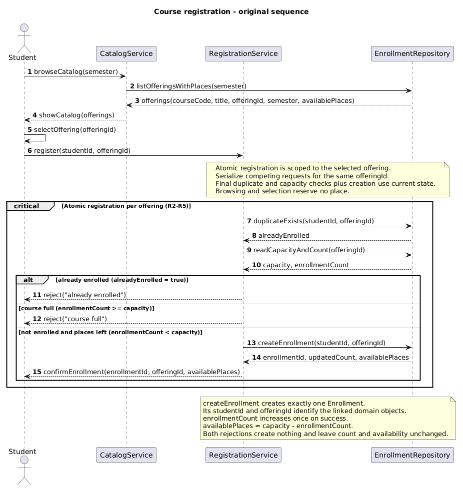
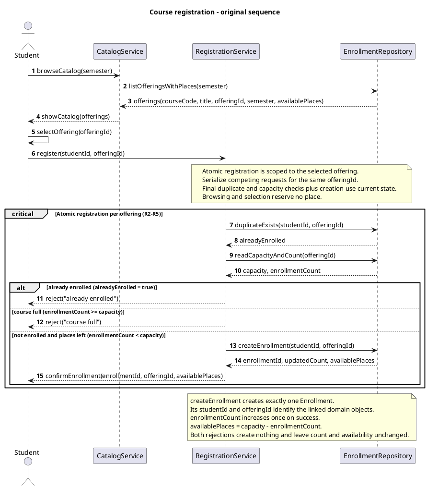
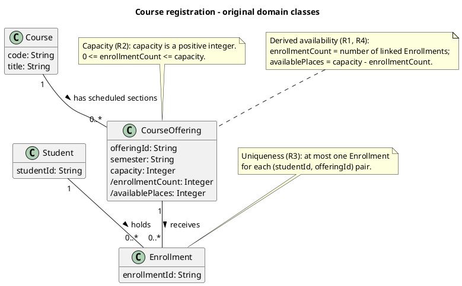
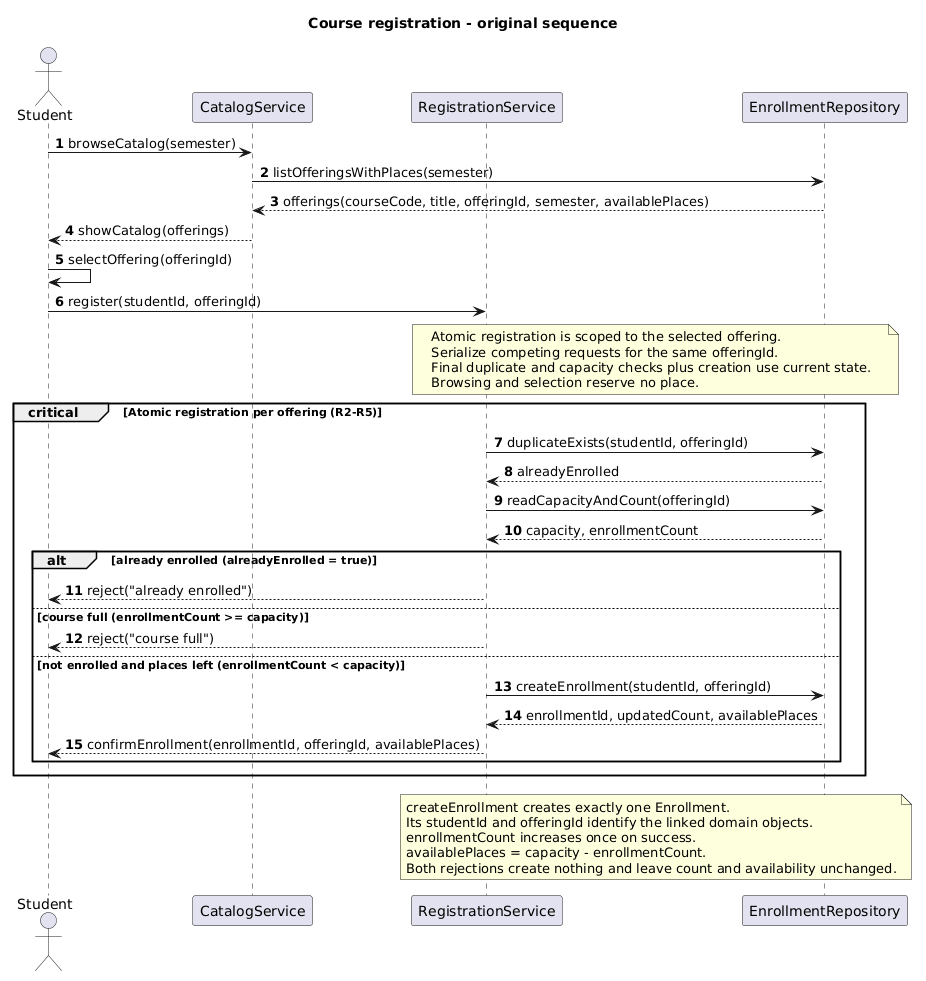
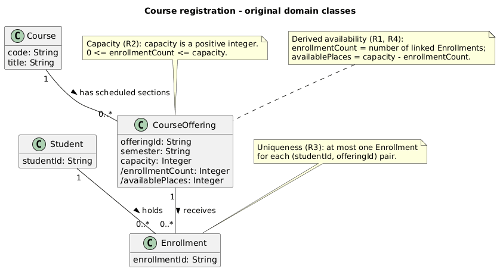

# SIS #02 — AI-Assisted UML Modeling: University Course Registration

<!--
  This is the only file you write your report in. README.md tells you what goes where.

  Rules the checker relies on:
  - Do not delete, rename or renumber the ## headings, the ### headings, or the **Label:** words.
  - Replace every "(write here)" and "(paste here)". None may be left when you submit.
  - Comments like this one are ignored by the checker and the word counter. Delete them or leave them.
-->

## 1. Scope and assumptions

**Scope:** Model how a signed-in student browses an electronic course catalog for one semester, selects a specific course offering, and requests registration. Cover the displayed course code, title, offering and available places, successful enrollment, and clear rejection when the offering is full or the student is already enrolled. Exclude payments, prerequisites, timetable clashes, waiting lists and cancellation. Use fictional students and courses; no working application or database implementation is required.

**Assumptions:**

1. The student is already signed in, the selected offering exists, and its capacity is a positive whole number, as specified in the scenario.
2. A Course describes a subject, while a CourseOffering identifies one scheduled section in one semester. Each registration request targets a CourseOffering rather than a Course in general.
3. Displayed availability is a snapshot and does not reserve a place. Registration must recheck duplicate enrollment and current capacity, then create the Enrollment within one atomic operation.
4. Available places equal the offering's capacity minus its current enrollment count. A successful request creates exactly one Enrollment; either rejection creates none and leaves the count unchanged.
5. When a request is both a duplicate and for a full offering, return "already enrolled" first. This is a chosen order for the two valid rejection reasons, not an additional university policy.

## 2. User stories and acceptance criteria

### US-01 — Browse offerings

**US-01:** As a student, I want to browse course offerings for a semester, so that I can choose a specific offering with visible availability.

- **AC-01** (R1): Given course offerings exist for a selected semester, When I browse that semester's catalog, Then it shows only offerings in that semester, with each offering's course code, title, offeringId and available places.
- **AC-02** (R1, R2): Given the catalog displays an offering's available places as capacity minus its current enrollment count at the time of reading, When I select that offering, Then its offeringId identifies the registration target, and browsing and selection create no Enrollment and reserve no place.

### US-02 — Register for an offering

**US-02:** As a student, I want to register for a selected offering, so that I receive an enrollment and confirmation when a place is available.

- **AC-03** (R2, R3, R4): Given I am not enrolled in the selected offering and its current enrollment count is below capacity, When I request registration, Then the system rechecks duplicates and current capacity after the request as one atomic operation with creation, creates exactly one Enrollment linking me to that offering, increases the count by one, recalculates available places and returns confirmation only after successful creation.
- **AC-04** (R2, R4): Given the selected offering has capacity 2, enrollment count 1 and no enrollment for me, When I request registration, Then atomic duplicate and capacity checks followed by exactly one creation change the count to 2 and available places to 0, and confirmation follows creation; competing requests cannot take the same last place.

### US-03 — Receive a clear rejection

**US-03:** As a student, I want a clear reason when registration is rejected, so that I understand whether the offering is full or I am already enrolled.

- **AC-05** (R2, R5): Given I am not enrolled and the catalog previously showed a place but the selected offering now has count 2 and capacity 2, When I request registration, Then the final capacity check returns "course full", creates no Enrollment, sends no success confirmation and leaves the count at 2 and available places at 0.
- **AC-06** (R3, R5): Given I already have an Enrollment in the selected offering, When I request registration again, Then the final duplicate check returns "already enrolled", creates no additional Enrollment, sends no success confirmation and leaves its enrollment count and available places unchanged.

**Requirements review (AI-assisted):** All six draft criteria were checked against R1–R5. AC-01 now states the semester filter explicitly; AC-02 defines the availability calculation and preserves selection without reservation. AC-03 clarifies that the final checks occur after the request and that confirmation follows creation. AC-04 uses the exact last-place state from T2. AC-05 makes the stale-catalog case and absence of confirmation explicit. AC-06 preserves both count and availability on a repeat request. No extra eligibility rule was accepted. This review was performed by the assistant at the student's request; it is not claimed as an independent student review.

## 3. Sequence diagram

<!-- The FINAL diagram, rendered. Change .png to .svg if that is what you exported. -->



**Participants:** (write here — each lifeline and what it stands for)

**Atomic operation:** (write here — which messages form the one atomic step: the final duplicate check, the capacity check and the creation of the Enrollment, and why a catalog view reserves nothing)

**Where the Enrollment is created:** (write here — which message, which lifeline, and which class in section 4 it produces)

**Technical lifelines:** (write here — every lifeline that is NOT a class in the class diagram, by name, and why the difference in abstraction is fine. "None" if there are none.)

## 4. Class diagram

<!-- The FINAL diagram, rendered. -->


<!-- One row per association in classes.puml, read in both directions. -->

| Association | Read left to right | Read right to left |
| --- | --- | --- |
| (write here) | (write here) | (write here) |
| (write here) | (write here) | (write here) |
| (write here) | (write here) | (write here) |

**How an Enrollment links a student to an offering:** (write here)

**Capacity constraint:** (write here — and why multiplicity alone cannot express it)

**Uniqueness constraint:** (write here — and why multiplicity alone cannot express it)

## 5. Traceability

<!-- Every rule, including the catalog fields and availability (R1). Column 1: the rule and
     the criteria that cover it, e.g. "R2 + AC-03, AC-04". Column 2: the message, guard,
     class or constraint that shows the rule in YOUR diagrams. Column 3: the T-ID that
     exercises it, or the extra check you did instead (R1 has no T case). -->

| Rule and criterion | Model evidence | Validation case |
| --- | --- | --- |
| R1 + (write here) | (write here) | (write here) |
| R2 + (write here) | (write here) | (write here) |
| R3 + (write here) | (write here) | (write here) |
| R4 + (write here) | (write here) | (write here) |
| R5 + (write here) | (write here) | (write here) |

## 6. Walkthroughs

<!-- Walk each case through YOUR final sequence diagram, message by message. Column 2: the
     actual steps and the state change (count before → after). Column 3 starts with Pass or
     Fail, then the location: the message, guard or note where you saw it. A Fail you
     report honestly is a finding, not a penalty. -->

| Case | Observed path and state change | Judgment and evidence |
| --- | --- | --- |
| T1. Available | (write here) | (write here) |
| T2. Last place | (write here) | (write here) |
| T3. Full | (write here) | (write here) |
| T4. Duplicate | (write here) | (write here) |

## 7. Review decisions

**Workflow note:** The baseline was committed as 27ba7f2 before Prompt A. At the student's request, the first push is deferred until the end, contrary to the README's required pre-Prompt A push. No earlier push is claimed.

<!-- At least three substantive decisions about Prompt C's critique or your own inspection.
     Decision: accepted / rejected / modified — and what you did. Reason: why, in a full
     sentence. Rule: R1–R5. Do not invent an error to fill the table; a justified rejection
     of advice counts. -->

| AI suggestion or model element | Decision | Reason | Rule |
| --- | --- | --- | --- |
| (write here) | (write here) | (write here) | (write here) |
| (write here) | (write here) | (write here) | (write here) |
| (write here) | (write here) | (write here) | (write here) |

## 8. Modeling explanation

<!-- 200–300 words. Your main design choices; how the class diagram and the sequence diagram
     complement each other; why an activity diagram could also help explain the workflow. -->

(write here)

## 9. Reflection

<!-- 150–200 words. Written by you, not by the assistant: where AI helped, one decision you
     made yourself, one remaining limitation. Specific beats flattering. -->

(write here)

## 10. Appendix A — Before AI

<!-- Written BEFORE you run Prompt A, committed and pushed in your first commit, and never
     edited afterwards. This is what you paste into Prompt A as "My initial assumptions". -->

**Scope:** Model how a signed-in student browses an electronic course catalog for one semester, selects a specific course offering, and requests registration. Cover the displayed course code, title, offering and available places, successful enrollment, and clear rejection when the offering is full or the student is already enrolled. Exclude payments, prerequisites, timetable clashes, waiting lists and cancellation. Use fictional students and courses; no working application or database implementation is required.

**Initial assumptions:**

1. The student is already signed in, the selected offering exists, and its capacity is a positive whole number, as specified in the scenario.
2. A Course describes a subject, while a CourseOffering identifies one scheduled section in one semester. Each registration request targets a CourseOffering rather than a Course in general.
3. Displayed availability is a snapshot and does not reserve a place. Registration must recheck duplicate enrollment and current capacity, then create the Enrollment within one atomic operation.
4. Available places equal the offering's capacity minus its current enrollment count. A successful request creates exactly one Enrollment; either rejection creates none and leaves the count unchanged.

## 11. Appendix B — AI exchanges

**Exchange provenance:** Prompts A and B are expanded from the README and answered directly by Codex in this session. The responses are preserved as generated; no external AI chat or API call is claimed.

<!-- Complete prompts and complete responses, as text — never screenshots. Paste each inside
     the ~~~~ block that follows its label: AI responses contain ``` PlantUML blocks, and
     ~~~~ keeps them from breaking this file. Prompts B and C: the prompt text first, then
     the material it refers to ("below", "these two") pasted under it, in the same block.
     You may add B5, B6 … after B4 if you ran more. -->

### B1 — Requirements (Prompt A)

- **Tool:** Codex (this session)
- **Model:** not displayed
- **Date:** 2026-10-18
- **Purpose:** draft 3 user stories and 6 acceptance criteria

**Prompt:**

~~~~text
Act as a requirements analyst. Use only this course registration scenario and rules R1–R5: A student browses an electronic course catalog, chooses a course offering and requests
registration. Each offering has a limited number of places.

A Course describes a subject. A CourseOffering is one scheduled section in one semester.
Registration always targets a specific offering.

Assume that the student is signed in, the selected offering exists, and its capacity is a
positive whole number.

Exclude payments, prerequisites, timetable clashes, waiting lists and cancellation. Use
fictional students and courses.

| Rule | |
| --- | --- |
| **R1. Catalog** | Show the course code, title, offering and available places for one semester. |
| **R2. Capacity** | Recheck current availability when registering. Enrollment must never exceed the offering's capacity. |
| **R3. Duplicates** | A student may have at most one enrollment in the same offering. Reject a repeat request. |
| **R4. Success** | Create exactly one Enrollment linking the student and offering, update availability and return a confirmation. |
| **R5. Rejection** | Explain "course full" or "already enrolled". Create no enrollment and leave the enrollment count unchanged. |

These rules define this assignment. **A catalog view does not reserve a place.** Model the final
checks and enrollment creation as one atomic operation so competing requests cannot take the same
last place. A note describing the atomic operation is sufficient; database implementation is
outside this assignment.. My initial assumptions are 1. The student is already signed in, the selected offering exists, and its capacity is a positive whole number, as specified in the scenario.
2. A Course describes a subject, while a CourseOffering identifies one scheduled section in one semester. Each registration request targets a CourseOffering rather than a Course in general.
3. Displayed availability is a snapshot and does not reserve a place. Registration must recheck duplicate enrollment and current capacity, then create the Enrollment within one atomic operation.
4. Available places equal the offering's capacity minus its current enrollment count. A successful request creates exactly one Enrollment; either rejection creates none and leaves the count unchanged..
Draft 3 user stories and 2 Given / When / Then acceptance criteria for each. Use IDs US-01 to US-03 and AC-01 to AC-06. Map each criterion to rule IDs.
Cover normal and rejection behavior. List uncertainty separately. Do not add excluded features or invent university policies.
~~~~

**Response:**

~~~~text
### US-01 — Browse offerings

**US-01:** As a student, I want to browse course offerings for a semester, so that I can choose a specific offering with visible availability.

- **AC-01** (R1): Given offerings exist for the selected semester, When I browse the catalog, Then each displayed offering includes its course code, course title, offering identity and available places for that semester.
- **AC-02** (R1, R2): Given I am viewing the catalog, When I select an offering, Then the selection identifies that specific offering and neither browsing nor selection creates an Enrollment or reserves a place.

### US-02 — Register for an offering

**US-02:** As a student, I want to register for a selected offering, so that I receive an enrollment and confirmation when a place is available.

- **AC-03** (R2, R3, R4): Given I have no enrollment in the selected offering and its current enrollment count is below capacity, When I request registration, Then the system atomically checks duplicate enrollment and current capacity, creates exactly one Enrollment linking me to that offering, increases its enrollment count by one, updates available places and returns confirmation after creation.
- **AC-04** (R2, R4): Given I am not enrolled and exactly one place remains in the selected offering, When I request registration, Then the atomic checks and creation accept the request, fill that last place and return confirmation; competing requests must not cause the offering to exceed capacity.

### US-03 — Receive a clear rejection

**US-03:** As a student, I want a clear reason when registration is rejected, so that I understand whether the offering is full or I am already enrolled.

- **AC-05** (R2, R5): Given I am not enrolled and the selected offering is currently full, When I request registration, Then the system rechecks current availability, returns "course full", creates no Enrollment and leaves the enrollment count unchanged.
- **AC-06** (R3, R5): Given I already have an Enrollment in the selected offering, When I request registration again, Then the system returns "already enrolled", creates no additional Enrollment and leaves the enrollment count unchanged.

### Uncertainty

The rules do not specify which reason takes priority when an offering is both full and already contains this student's enrollment. A duplicate-first check is a possible modeling choice, not an additional university policy. Both checks must still occur before any successful creation.

An offering identity needs to distinguish scheduled sections within a semester; an offeringId is a suitable modeling identifier. Its storage format is unspecified and unnecessary here.

No additional eligibility rules or student data are needed. Authentication, offering existence and positive integer capacity are supplied assumptions. Catalog availability remains a snapshot until the atomic registration operation rechecks the current state.
~~~~

### B2 — UML drafts (Prompt B)

- **Tool:** Codex (this session)
- **Model:** not displayed
- **Date:** 2026-10-18
- **Purpose:** draft the sequence and class diagrams

**Prompt:**

~~~~text
Using my approved scenario, R1–R5, stories and criteria below, return separate PlantUML code blocks for a sequence diagram and a domain class diagram.
Sequence: include catalog browsing and guarded success, full-course and duplicate outcomes. Model final checks and creation as one atomic operation.
Class: show domain concepts, useful attributes and multiplicities. State the capacity and uniqueness constraints. Explain assumptions and any technical lifelines.

Approved scenario and rules:
A student browses an electronic course catalog, chooses a course offering and requests
registration. Each offering has a limited number of places.

A Course describes a subject. A CourseOffering is one scheduled section in one semester.
Registration always targets a specific offering.

Assume that the student is signed in, the selected offering exists, and its capacity is a
positive whole number.

Exclude payments, prerequisites, timetable clashes, waiting lists and cancellation. Use
fictional students and courses.

| Rule | |
| --- | --- |
| **R1. Catalog** | Show the course code, title, offering and available places for one semester. |
| **R2. Capacity** | Recheck current availability when registering. Enrollment must never exceed the offering's capacity. |
| **R3. Duplicates** | A student may have at most one enrollment in the same offering. Reject a repeat request. |
| **R4. Success** | Create exactly one Enrollment linking the student and offering, update availability and return a confirmation. |
| **R5. Rejection** | Explain "course full" or "already enrolled". Create no enrollment and leave the enrollment count unchanged. |

These rules define this assignment. **A catalog view does not reserve a place.** Model the final
checks and enrollment creation as one atomic operation so competing requests cannot take the same
last place. A note describing the atomic operation is sufficient; database implementation is
outside this assignment.

Approved scope assumptions:
1. The student is already signed in, the selected offering exists, and its capacity is a positive whole number, as specified in the scenario.
2. A Course describes a subject, while a CourseOffering identifies one scheduled section in one semester. Each registration request targets a CourseOffering rather than a Course in general.
3. Displayed availability is a snapshot and does not reserve a place. Registration must recheck duplicate enrollment and current capacity, then create the Enrollment within one atomic operation.
4. Available places equal the offering's capacity minus its current enrollment count. A successful request creates exactly one Enrollment; either rejection creates none and leaves the count unchanged.
5. If the same request is both a duplicate and for a full offering, return "already enrolled" first.

Approved stories and acceptance criteria:
### US-01 — Browse offerings

**US-01:** As a student, I want to browse course offerings for a semester, so that I can choose a specific offering with visible availability.

- **AC-01** (R1): Given course offerings exist for a selected semester, When I browse that semester's catalog, Then it shows only offerings in that semester, with each offering's course code, title, offeringId and available places.
- **AC-02** (R1, R2): Given the catalog displays an offering's available places as capacity minus its current enrollment count at the time of reading, When I select that offering, Then its offeringId identifies the registration target, and browsing and selection create no Enrollment and reserve no place.

### US-02 — Register for an offering

**US-02:** As a student, I want to register for a selected offering, so that I receive an enrollment and confirmation when a place is available.

- **AC-03** (R2, R3, R4): Given I am not enrolled in the selected offering and its current enrollment count is below capacity, When I request registration, Then the system rechecks duplicates and current capacity after the request as one atomic operation with creation, creates exactly one Enrollment linking me to that offering, increases the count by one, recalculates available places and returns confirmation only after successful creation.
- **AC-04** (R2, R4): Given the selected offering has capacity 2, enrollment count 1 and no enrollment for me, When I request registration, Then atomic duplicate and capacity checks followed by exactly one creation change the count to 2 and available places to 0, and confirmation follows creation; competing requests cannot take the same last place.

### US-03 — Receive a clear rejection

**US-03:** As a student, I want a clear reason when registration is rejected, so that I understand whether the offering is full or I am already enrolled.

- **AC-05** (R2, R5): Given I am not enrolled and the catalog previously showed a place but the selected offering now has count 2 and capacity 2, When I request registration, Then the final capacity check returns "course full", creates no Enrollment, sends no success confirmation and leaves the count at 2 and available places at 0.
- **AC-06** (R3, R5): Given I already have an Enrollment in the selected offering, When I request registration again, Then the final duplicate check returns "already enrolled", creates no additional Enrollment, sends no success confirmation and leaves its enrollment count and available places unchanged.
~~~~

**Response:**

~~~~text
### Sequence diagram



### Domain class diagram



### Assumptions and technical lifelines

Student is the signed-in actor and corresponds to the Student domain concept. CatalogService, RegistrationService and EnrollmentRepository are technical lifelines: they describe catalog delivery, coordination of registration, and reading or recording domain state. They are not additional domain classes.

A CourseOffering has its own offeringId, belongs to one Course and records its semester. A Course may have zero or more scheduled offerings; no rule requires every catalog subject to have a scheduled section. Each Enrollment links exactly one Student and one CourseOffering through the associations. Each student or offering can participate in zero or more Enrollment objects, subject to the two separate constraints.

The slash prefix marks enrollmentCount and availablePlaces as derived values. Creating an Enrollment changes the count of linked records and therefore the calculated availability; no independent availability counter is introduced.

The final duplicate and capacity reads and successful creation form one atomic operation for the selected offering. The critical fragment and its note specify serialization of competing requests; no database implementation is assumed. The capacity read follows the registration request, so a stale catalog cannot authorize enrollment.

The duplicate branch takes priority when both rejection conditions hold. Both rejection paths return a reason without creating an Enrollment or sending confirmation. Only the successful branch calls createEnrollment, and its confirmation follows that call.

The operation's returned enrollmentId identifies the one created Enrollment. The studentId and offeringId arguments identify the Student and CourseOffering it links. The repository returns the updated count and derived available places.

The catalog returns one semester's offerings with the required course code, title, offering identity and available places. The student's explicit self-message selects the offering before the registration request. Browsing and selection perform no enrollment write.
~~~~

### B3 — Model critique (Prompt C)

- **Tool:** (write here)
- **Model:** (write here)
- **Date:** (write here)
- **Purpose:** review both models against R1–R5 and T1–T4

**Prompt:**

~~~~text
(paste here)
~~~~

**Response:**

~~~~text
(paste here)
~~~~

### B4 — Focused revision (Prompt D)

- **Tool:** (write here)
- **Model:** (write here)
- **Date:** (write here)
- **Purpose:** apply my accepted review decisions

**Prompt:**

~~~~text
(paste here)
~~~~

**Response:**

~~~~text
(paste here)
~~~~

## 12. Appendix C — Original diagrams

<!-- The AI's first output from Prompt B, rendered unedited from models/original/. -->





## 13. Appendix D — References and source checks

### References

<!-- Full references, one per line, each starting with "- ". Only sources you actually opened.
     Every URL used in the source checks must also appear here. Example:
     - Sommerville, I. (2016). Software Engineering, 10th ed., Global Edition. Pearson. Ch. 5. -->

- (write here)

### Source checks

<!-- At least two modeling decisions you verified. Source and locator: title + slide, page,
     section, chapter or figure — or title + URL + access date (YYYY-MM-DD). Slide numbers
     refer to the decks posted in our Teams. -->

| Modeling decision | Source and locator | What the source says | How it supports or changed your model |
| --- | --- | --- | --- |
| (write here) | (write here) | (write here) | (write here) |
| (write here) | (write here) | (write here) | (write here) |
