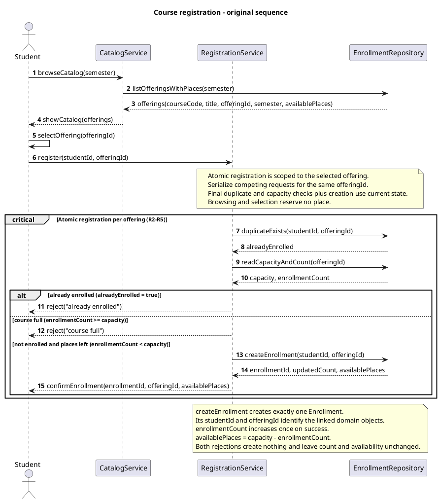
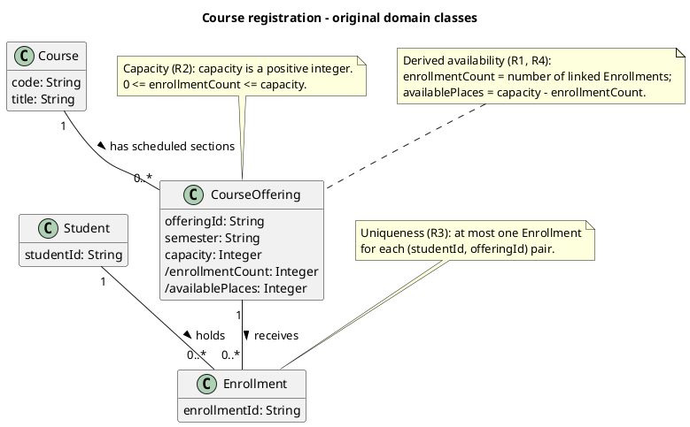

# SIS #02 — AI-Assisted UML Modeling: University Course Registration

<!--
  This is the only file you write your report in. README.md tells you what goes where.

  Rules the checker relies on:
  - Do not delete, rename or renumber the ## headings, the ### headings, or the **Label:** words.
  - Replace every "(write here)" and "(paste here)". None may be left when you submit.
  - Comments like this one are ignored by the checker and the word counter. Delete them or leave them.
-->

## 1. Scope and assumptions

**Scope:** Model how a signed-in student browses an electronic course catalog for one semester, selects a specific course offering, and requests registration. Cover the displayed course code, title, offering and available places, successful enrollment, and clear rejection when the offering is full or the student is already enrolled. Exclude payments, prerequisites, timetable clashes, waiting lists and cancellation. Use fictional students and courses; no working application or database implementation is required.

**Assumptions:**

1. The student is already signed in, the selected offering exists, and its capacity is a positive whole number, as specified in the scenario.
2. A Course describes a subject, while a CourseOffering identifies one scheduled section in one semester. Each registration request targets a CourseOffering rather than a Course in general.
3. Displayed availability is a snapshot and does not reserve a place. Registration must recheck duplicate enrollment and current capacity, then create the Enrollment within one atomic operation.
4. Available places equal the offering's capacity minus its current enrollment count. A successful request creates exactly one Enrollment; either rejection creates none and leaves the count unchanged.
5. When a request is both a duplicate and for a full offering, return "already enrolled" first. This is a chosen order for the two valid rejection reasons, not an additional university policy.

## 2. User stories and acceptance criteria

### US-01 — Browse offerings

**US-01:** As a student, I want to browse course offerings for a semester, so that I can choose a specific offering with visible availability.

- **AC-01** (R1): Given course offerings exist for a selected semester, When I browse that semester's catalog, Then it shows only offerings in that semester, with each offering's course code, title, offeringId and available places.
- **AC-02** (R1, R2): Given the catalog displays an offering's available places as capacity minus its current enrollment count at the time of reading, When I select that offering, Then its offeringId identifies the registration target, and browsing and selection create no Enrollment and reserve no place.

### US-02 — Register for an offering

**US-02:** As a student, I want to register for a selected offering, so that I receive an enrollment and confirmation when a place is available.

- **AC-03** (R2, R3, R4): Given I am not enrolled in the selected offering and its current enrollment count is below capacity, When I request registration, Then the system rechecks duplicates and current capacity after the request as one atomic operation with creation, creates exactly one Enrollment linking me to that offering, increases the count by one, recalculates available places and returns confirmation only after successful creation.
- **AC-04** (R2, R4): Given the selected offering has capacity 2, enrollment count 1 and no enrollment for me, When I request registration, Then atomic duplicate and capacity checks followed by exactly one creation change the count to 2 and available places to 0, and confirmation follows creation; competing requests cannot take the same last place.

### US-03 — Receive a clear rejection

**US-03:** As a student, I want a clear reason when registration is rejected, so that I understand whether the offering is full or I am already enrolled.

- **AC-05** (R2, R5): Given I am not enrolled and the catalog previously showed a place but the selected offering now has count 2 and capacity 2, When I request registration, Then the final capacity check returns "course full", creates no Enrollment, sends no success confirmation and leaves the count at 2 and available places at 0.
- **AC-06** (R3, R5): Given I already have an Enrollment in the selected offering, When I request registration again, Then the final duplicate check returns "already enrolled", creates no additional Enrollment, sends no success confirmation and leaves its enrollment count and available places unchanged.

**Requirements review (AI-assisted):** All six draft criteria were checked against R1–R5. AC-01 now states the semester filter explicitly; AC-02 defines the availability calculation and preserves selection without reservation. AC-03 clarifies that the final checks occur after the request and that confirmation follows creation. AC-04 uses the exact last-place state from T2. AC-05 makes the stale-catalog case and absence of confirmation explicit. AC-06 preserves both count and availability on a repeat request. No extra eligibility rule was accepted. This review was performed by the assistant at the student's request; it is not claimed as an independent student review.

## 3. Sequence diagram


**Participants:** Student is the signed-in student selecting an offering. CatalogService supplies the semester catalog. RegistrationService coordinates one registration request and its result. EnrollmentRepository reads catalog and enrollment state and creates the Enrollment on success.

**Atomic operation:** The critical fragment "Atomic registration per offering (R2-R5)" contains duplicateExists(studentId, offeringId), readCapacityAndCount(offeringId), their returned current values, the guarded decision and, on success, createEnrollment(studentId, offeringId). Its note requires competing requests for the same offeringId to be serialized across these checks and creation. A catalog view reserves nothing; the capacity used for registration is reread after register. Both rejection branches only return a reason and change no state.

**Where the Enrollment is created:** Message 13, RegistrationService -> EnrollmentRepository: createEnrollment(studentId, offeringId), creates exactly one instance of the Enrollment class in section 4. Message 14 returns its enrollmentId, updatedCount and availablePlaces. Only then does message 15 confirmEnrollment return success to Student.

**Technical lifelines:** CatalogService, RegistrationService and EnrollmentRepository are application or persistence responsibilities in the interaction, not domain concepts. They are therefore absent from the class diagram, which deliberately contains Student, Course, CourseOffering and Enrollment. The Student actor and Student class describe the same role at different levels. The repository represents domain state access without specifying a database implementation.

**Guard wording:** In the final source, "not already enrolled" explicitly means alreadyEnrolled = false, as stated in the atomic-operation note. This makes the duplicate, full and success guards mutually exclusive without confusing the checker.

## 4. Class diagram


The final class source is identical to Prompt B's original, as justified in section 7. Its original render is reused without changing the model.

| Association | Read left to right | Read right to left |
| --- | --- | --- |
| Student "1" -- "0..*" Enrollment: holds | One Student can hold zero or more Enrollment objects. | Each Enrollment belongs to exactly one Student. |
| CourseOffering "1" -- "0..*" Enrollment: receives | One CourseOffering can receive zero or more Enrollment objects, subject to its capacity. | Each Enrollment targets exactly one CourseOffering. |
| Course "1" -- "0..*" CourseOffering: has scheduled sections | One Course can have zero or more scheduled CourseOffering objects. | Each CourseOffering describes a scheduled section of exactly one Course. |

**How an Enrollment links a student to an offering:** Each Enrollment has its own enrollmentId and exactly one association to a Student and one to a CourseOffering. The studentId and offeringId passed to createEnrollment identify those two linked objects. The target offering's association to Course supplies its code and title. Separate foreign-key attributes in Enrollment are unnecessary at this domain abstraction.

**Capacity constraint:** N1 states that capacity is a positive integer and 0 <= enrollmentCount <= capacity. The derived enrollmentCount counts linked Enrollment objects; availablePlaces equals capacity minus that count, as N3 states. A constant multiplicity such as 0..* cannot express the different capacity value of each offering.

**Uniqueness constraint:** N2 permits at most one Enrollment for each (studentId, offeringId) pair. Multiplicities permit many enrollments per student and per offering, but do not prevent two Enrollment objects from linking the same pair. The separate constraint supplies that restriction.

## 5. Traceability

| Rule and criterion | Model evidence | Validation case |
| --- | --- | --- |
| R1 + AC-01, AC-02 | browseCatalog(semester), listOfferingsWithPlaces(semester), offerings(courseCode, title, offeringId, semester, availablePlaces), showCatalog and the requested-semester note; Course.code/title, CourseOffering.semester and derived availablePlaces. | Catalog inspection C1: checked that all five response fields are present, the note filters the requested semester, courseCode maps to Course.code, and messages 1-5 contain no write or reservation. |
| R2 + AC-02, AC-03, AC-04, AC-05 | readCapacityAndCount occurs after register; the full and success guards use that count; the critical fragment serializes checks and creation; N1 bounds enrollmentCount by capacity. | T1, T2 and T3; extra check E2 traces two serialized competitors for the last place. |
| R3 + AC-03, AC-06 | duplicateExists precedes creation; duplicate guard requires alreadyEnrolled = true and both other guards require not already enrolled; N2 limits each student/offering pair to one Enrollment. | T4; extra check E1 combines duplicate registration with a full offering. |
| R4 + AC-03, AC-04 | Success branch calls createEnrollment exactly once, returns enrollmentId/updatedCount/availablePlaces, then confirmEnrollment; N3 derives the updated count and availability from Enrollment links. | T1 changes count 0 to 1; T2 changes count 1 to 2. |
| R5 + AC-05, AC-06 | reject("course full") and reject("already enrolled") are in separate guarded branches with no create or confirmation; the final note preserves count and availability on rejection. | T3 and T4; extra check E1 preserves full-offering state on duplicate rejection. |

## 6. Walkthroughs

These are source walkthroughs performed by Codex on the saved final diagram, not executions of an application or an independently written student validation. Cases use fictional students S-A, S-B and S-C and offering CS101-F26-A of Course CS101, "Introduction to Computing", in Fall 2026.

**Common path, messages 1-6:** Student sends browseCatalog(semester); CatalogService sends listOfferingsWithPlaces(semester); EnrollmentRepository returns offerings(courseCode, title, offeringId, semester, availablePlaces); CatalogService sends showCatalog(offerings); Student performs selectOffering(offeringId); Student sends register(studentId, offeringId) to RegistrationService. The requested semester is filtered and selection reserves nothing. Each table row continues this path through the current-state checks and its selected branch.

| Case | Observed path and state change | Judgment and evidence |
| --- | --- | --- |
| T1. Available | For new student S-A, follow common messages 1-6. Message 7 duplicateExists returns false in 8. Message 9 readCapacityAndCount returns capacity 2 and count 0 in 10. Only the success guard is true. Message 13 createEnrollment creates one linked record; 14 returns its enrollmentId, updatedCount 1 and availablePlaces 1; 15 confirmEnrollment returns confirmation. Count 0 -> 1; available places 2 -> 1. | Pass — success guard, createEnrollment (13), returned updatedCount (14), confirmEnrollment (15) and the atomic-operation note. |
| T2. Last place | Student S-A already occupies one of two places; S-B follows common messages 1-6. Message 7 duplicateExists returns false in 8; 9 readCapacityAndCount returns capacity 2 and count 1 in 10. The success guard selects 13 createEnrollment exactly once. Message 14 returns updatedCount 2 and availablePlaces 0; 15 confirms. Count 1 -> 2; available places 1 -> 0. | Pass — success guard uses current count below capacity; createEnrollment (13) and response (14) fill exactly the last place inside the critical fragment. |
| T3. Full | S-C follows common messages 1-6. The catalog response in 3 showed one place, but another request completes before register (6), so the current count is now 2. Message 7 duplicateExists returns false in 8; 9 readCapacityAndCount returns capacity 2 and count 2 in 10. Only the full guard is true, selecting 12 reject("course full"). Messages 13-15 do not execute. Count 2 -> 2; current available places 0 -> 0. | Pass — readCapacityAndCount (9-10), full guard requiring not already enrolled and enrollmentCount >= capacity, reject("course full") (12), and the unchanged-state note. |
| T4. Duplicate | Student S-A is already enrolled while count is 1 of 2, and follows common messages 1-6 again. Message 7 duplicateExists returns true in 8; 9 readCapacityAndCount returns capacity 2 and count 1 in 10. Only the duplicate guard is true, selecting 11 reject("already enrolled"). No creation or confirmation runs. Count 1 -> 1; available places 1 -> 1. | Pass — duplicateExists (7-8), alreadyEnrolled = true guard, reject("already enrolled") (11), and both other guards explicitly requiring not already enrolled. |

**Extra check E1 — duplicate and full:** Start with S-A already enrolled, capacity 2 and count 2. After the common path, duplicateExists returns true and readCapacityAndCount returns 2/2. In the original diagram both rejection guards could be enabled. In the final diagram the full and success guards require not already enrolled (defined as alreadyEnrolled = false), so only message 11 returns "already enrolled". No Enrollment is created; count stays 2 and available places stay 0. Pass at the three mutually exclusive guards.

**Extra check E2 — competing last-place requests:** Start with one existing enrollment at capacity 2. S-B and S-C both see one place in their catalog views. Under the per-offering serialization note, S-B's atomic operation reads no duplicate and count 1, creates one Enrollment, returns count 2 and confirms. S-C's later atomic operation reads no duplicate and the new count 2, takes the full guard and rejects without creation. Final count is 2, not 3. Reversing the order swaps which student succeeds. Pass at the atomic note and the final capacity read.

## 7. Review decisions

**Workflow note:** The baseline was committed as 27ba7f2 before Prompt A. At the student's request, the first push is deferred until the end, contrary to the README's required pre-Prompt A push. No earlier push is claimed.

**Review provenance:** Prompt C ran in a separate agent with empty conversation context. Codex evaluated the decisions below as delegated assistance; an independent student review is not claimed.

| AI suggestion or model element | Decision | Reason | Rule |
| --- | --- | --- | --- |
| C: the duplicate and full guards overlap when alreadyEnrolled is true and count equals capacity. | Modified / accepted: add alreadyEnrolled = false to the full and success guards; keep alreadyEnrolled = true for duplicate rejection. Relabel the revised sequence as final. | At count 2 of 2 for an enrolled student, only duplicate rejection may be enabled because AC-06 requires that reason. | R3, R5 |
| C: the proposed replacement writes guards inside square brackets. | Modified: keep the existing descriptive alt/else labels and write the conditions without literal square brackets. | The README explicitly requires guards without square brackets because PlantUML supplies them and additional brackets can render as links. | R3, R5 |
| C: an explicit semester-filter note would strengthen the catalog flow. | Accepted as clarification: note that listOfferingsWithPlaces returns only the requested semester, with courseCode projected from Course.code. | AC-01 requires one semester's offerings, so the note makes the existing message parameter's intended filter explicit without adding behavior. | R1 |
| C: add the case where the same student is already enrolled and the offering is full. | Accepted: trace this as an extra check after T1-T4, including the original ambiguity and the corrected unique guard. | The four required cases do not combine both rejection conditions, so this check directly exercises the guard correction. | R3, R5 |
| C: retain the three associations, the derived availability and the two separate constraints. | Accepted: keep the original class source unchanged, including Course 1 to CourseOffering 0..* and one Student and CourseOffering per Enrollment. | No rule requires every Course to have a scheduled section, and multiplicities cannot express pair uniqueness or each offering's variable capacity. | R1, R2, R3, R4 |
| C: reading capacity after a duplicate is redundant; technical lifelines can stay outside the domain diagram. | Rejected restructuring as unnecessary; keep both read operations before the alternatives and explain all three technical lifelines in section 3. | Both operations only read current state, while the atomic operation already prevents races and every rejection leaves the count unchanged. | R2, R3, R5 |
| Post-D checker inspection: the lexical checker classifies alreadyEnrolled = false as a duplicate rejection. | Modified guard wording only: use not already enrolled in the full and success guards, and define it as alreadyEnrolled = false in the atomic note. | The equivalent negative phrase preserves mutually exclusive outcomes while allowing the required checker to distinguish success and full rejection correctly. | R2, R3, R5 |

**Post-D refinement:** The final sequence uses the negative guard wording described above. The B4 response is preserved unchanged as evidence; the equivalent wording adjustment belongs only to the saved final source.

## 8. Modeling explanation

The domain model separates a Course, which describes a subject, from a CourseOffering, which identifies one scheduled section in a semester. Registration targets the offering because its capacity and enrollments belong to that section. Enrollment represents the link between one Student and one CourseOffering, while its identifier lets the sequence return a specific confirmation.

The three associations describe structural possibilities. A student or offering can have many enrollments, and a course can have several scheduled sections or none. Separate notes express the actual restrictions: an offering's enrollment count cannot exceed its capacity, and the same student and offering cannot be linked twice. Derived enrollmentCount and availablePlaces avoid treating availability as an independently maintained domain value.

The sequence diagram adds order and conditional behavior to that structure. It shows the catalog fields, selection, registration request, final checks, one creation and confirmation. The catalog is a snapshot. Only the atomic registration operation can decide whether a place remains, and its note requires competing requests for one offering to be serialized. Explicit, mutually exclusive guards distinguish duplicate rejection, full rejection and success, including the case where a duplicate also targets a full offering.

The diagrams therefore answer different questions: the class diagram identifies objects and constraints, while the sequence diagram shows how a request respects them. Technical service and repository lifelines coordinate these domain objects without becoming extra domain classes.

An activity diagram could also present the workflow as actions and decisions, making the three outcomes easier to follow without tracking messages between lifelines. It would complement the interaction view, while the class diagram would still supply the relationships and invariants.

## 9. Reflection

**AI-assisted reflection draft:** AI supplied the requirements draft, the UML sources, an independent critique and the written walkthroughs. This helped organize the evidence around specific messages, guards and constraints. The separate review found an overlap between duplicate and full rejection guards that the four required cases alone did not expose. That finding shows why a readable diagram and a passing structural checker are insufficient evidence of correct behavior.

My process decisions were to handle the commits myself, render the diagrams on the website and defer pushes until the end. The last choice differs from the README, so the report records the actual order instead of claiming an earlier push.

A remaining limitation is that the atomic-operation note specifies concurrency behavior without implementing or testing a database transaction. The extra last-place walkthrough checks the modeled ordering, but cannot establish that a future application enforces it.

This reflection, the baseline and the walkthrough text were prepared with AI assistance. They are disclosed accordingly. Independent student understanding and personal wording still need to be assessed before submission; this draft does not claim that verification has happened.

## 10. Appendix A — Before AI

<!-- Written BEFORE you run Prompt A, committed and pushed in your first commit, and never
     edited afterwards. This is what you paste into Prompt A as "My initial assumptions". -->

**Scope:** Model how a signed-in student browses an electronic course catalog for one semester, selects a specific course offering, and requests registration. Cover the displayed course code, title, offering and available places, successful enrollment, and clear rejection when the offering is full or the student is already enrolled. Exclude payments, prerequisites, timetable clashes, waiting lists and cancellation. Use fictional students and courses; no working application or database implementation is required.

**Initial assumptions:**

1. The student is already signed in, the selected offering exists, and its capacity is a positive whole number, as specified in the scenario.
2. A Course describes a subject, while a CourseOffering identifies one scheduled section in one semester. Each registration request targets a CourseOffering rather than a Course in general.
3. Displayed availability is a snapshot and does not reserve a place. Registration must recheck duplicate enrollment and current capacity, then create the Enrollment within one atomic operation.
4. Available places equal the offering's capacity minus its current enrollment count. A successful request creates exactly one Enrollment; either rejection creates none and leaves the count unchanged.

## 11. Appendix B — AI exchanges

**Exchange provenance:** Prompts A, B and D were expanded from the README and answered directly by Codex in this session. Prompt C was sent verbatim with the supplied models and requirements to a separate Codex agent with empty conversation context, as authorized by the student. All four responses are preserved as generated; no external AI chat or API call is claimed.

<!-- Complete prompts and complete responses, as text — never screenshots. Paste each inside
     the ~~~~ block that follows its label: AI responses contain ``` PlantUML blocks, and
     ~~~~ keeps them from breaking this file. Prompts B and C: the prompt text first, then
     the material it refers to ("below", "these two") pasted under it, in the same block.
     You may add B5, B6 … after B4 if you ran more. -->

### B1 — Requirements (Prompt A)

- **Tool:** Codex (this session)
- **Model:** not displayed
- **Date:** 2026-10-18
- **Purpose:** draft 3 user stories and 6 acceptance criteria

**Prompt:**

~~~~text
Act as a requirements analyst. Use only this course registration scenario and rules R1–R5: A student browses an electronic course catalog, chooses a course offering and requests
registration. Each offering has a limited number of places.

A Course describes a subject. A CourseOffering is one scheduled section in one semester.
Registration always targets a specific offering.

Assume that the student is signed in, the selected offering exists, and its capacity is a
positive whole number.

Exclude payments, prerequisites, timetable clashes, waiting lists and cancellation. Use
fictional students and courses.

| Rule | |
| --- | --- |
| **R1. Catalog** | Show the course code, title, offering and available places for one semester. |
| **R2. Capacity** | Recheck current availability when registering. Enrollment must never exceed the offering's capacity. |
| **R3. Duplicates** | A student may have at most one enrollment in the same offering. Reject a repeat request. |
| **R4. Success** | Create exactly one Enrollment linking the student and offering, update availability and return a confirmation. |
| **R5. Rejection** | Explain "course full" or "already enrolled". Create no enrollment and leave the enrollment count unchanged. |

These rules define this assignment. **A catalog view does not reserve a place.** Model the final
checks and enrollment creation as one atomic operation so competing requests cannot take the same
last place. A note describing the atomic operation is sufficient; database implementation is
outside this assignment.. My initial assumptions are 1. The student is already signed in, the selected offering exists, and its capacity is a positive whole number, as specified in the scenario.
2. A Course describes a subject, while a CourseOffering identifies one scheduled section in one semester. Each registration request targets a CourseOffering rather than a Course in general.
3. Displayed availability is a snapshot and does not reserve a place. Registration must recheck duplicate enrollment and current capacity, then create the Enrollment within one atomic operation.
4. Available places equal the offering's capacity minus its current enrollment count. A successful request creates exactly one Enrollment; either rejection creates none and leaves the count unchanged..
Draft 3 user stories and 2 Given / When / Then acceptance criteria for each. Use IDs US-01 to US-03 and AC-01 to AC-06. Map each criterion to rule IDs.
Cover normal and rejection behavior. List uncertainty separately. Do not add excluded features or invent university policies.
~~~~

**Response:**

~~~~text
### US-01 — Browse offerings

**US-01:** As a student, I want to browse course offerings for a semester, so that I can choose a specific offering with visible availability.

- **AC-01** (R1): Given offerings exist for the selected semester, When I browse the catalog, Then each displayed offering includes its course code, course title, offering identity and available places for that semester.
- **AC-02** (R1, R2): Given I am viewing the catalog, When I select an offering, Then the selection identifies that specific offering and neither browsing nor selection creates an Enrollment or reserves a place.

### US-02 — Register for an offering

**US-02:** As a student, I want to register for a selected offering, so that I receive an enrollment and confirmation when a place is available.

- **AC-03** (R2, R3, R4): Given I have no enrollment in the selected offering and its current enrollment count is below capacity, When I request registration, Then the system atomically checks duplicate enrollment and current capacity, creates exactly one Enrollment linking me to that offering, increases its enrollment count by one, updates available places and returns confirmation after creation.
- **AC-04** (R2, R4): Given I am not enrolled and exactly one place remains in the selected offering, When I request registration, Then the atomic checks and creation accept the request, fill that last place and return confirmation; competing requests must not cause the offering to exceed capacity.

### US-03 — Receive a clear rejection

**US-03:** As a student, I want a clear reason when registration is rejected, so that I understand whether the offering is full or I am already enrolled.

- **AC-05** (R2, R5): Given I am not enrolled and the selected offering is currently full, When I request registration, Then the system rechecks current availability, returns "course full", creates no Enrollment and leaves the enrollment count unchanged.
- **AC-06** (R3, R5): Given I already have an Enrollment in the selected offering, When I request registration again, Then the system returns "already enrolled", creates no additional Enrollment and leaves the enrollment count unchanged.

### Uncertainty

The rules do not specify which reason takes priority when an offering is both full and already contains this student's enrollment. A duplicate-first check is a possible modeling choice, not an additional university policy. Both checks must still occur before any successful creation.

An offering identity needs to distinguish scheduled sections within a semester; an offeringId is a suitable modeling identifier. Its storage format is unspecified and unnecessary here.

No additional eligibility rules or student data are needed. Authentication, offering existence and positive integer capacity are supplied assumptions. Catalog availability remains a snapshot until the atomic registration operation rechecks the current state.
~~~~

### B2 — UML drafts (Prompt B)

- **Tool:** Codex (this session)
- **Model:** not displayed
- **Date:** 2026-10-18
- **Purpose:** draft the sequence and class diagrams

**Prompt:**

~~~~text
Using my approved scenario, R1–R5, stories and criteria below, return separate PlantUML code blocks for a sequence diagram and a domain class diagram.
Sequence: include catalog browsing and guarded success, full-course and duplicate outcomes. Model final checks and creation as one atomic operation.
Class: show domain concepts, useful attributes and multiplicities. State the capacity and uniqueness constraints. Explain assumptions and any technical lifelines.

Approved scenario and rules:
A student browses an electronic course catalog, chooses a course offering and requests
registration. Each offering has a limited number of places.

A Course describes a subject. A CourseOffering is one scheduled section in one semester.
Registration always targets a specific offering.

Assume that the student is signed in, the selected offering exists, and its capacity is a
positive whole number.

Exclude payments, prerequisites, timetable clashes, waiting lists and cancellation. Use
fictional students and courses.

| Rule | |
| --- | --- |
| **R1. Catalog** | Show the course code, title, offering and available places for one semester. |
| **R2. Capacity** | Recheck current availability when registering. Enrollment must never exceed the offering's capacity. |
| **R3. Duplicates** | A student may have at most one enrollment in the same offering. Reject a repeat request. |
| **R4. Success** | Create exactly one Enrollment linking the student and offering, update availability and return a confirmation. |
| **R5. Rejection** | Explain "course full" or "already enrolled". Create no enrollment and leave the enrollment count unchanged. |

These rules define this assignment. **A catalog view does not reserve a place.** Model the final
checks and enrollment creation as one atomic operation so competing requests cannot take the same
last place. A note describing the atomic operation is sufficient; database implementation is
outside this assignment.

Approved scope assumptions:
1. The student is already signed in, the selected offering exists, and its capacity is a positive whole number, as specified in the scenario.
2. A Course describes a subject, while a CourseOffering identifies one scheduled section in one semester. Each registration request targets a CourseOffering rather than a Course in general.
3. Displayed availability is a snapshot and does not reserve a place. Registration must recheck duplicate enrollment and current capacity, then create the Enrollment within one atomic operation.
4. Available places equal the offering's capacity minus its current enrollment count. A successful request creates exactly one Enrollment; either rejection creates none and leaves the count unchanged.
5. If the same request is both a duplicate and for a full offering, return "already enrolled" first.

Approved stories and acceptance criteria:
### US-01 — Browse offerings

**US-01:** As a student, I want to browse course offerings for a semester, so that I can choose a specific offering with visible availability.

- **AC-01** (R1): Given course offerings exist for a selected semester, When I browse that semester's catalog, Then it shows only offerings in that semester, with each offering's course code, title, offeringId and available places.
- **AC-02** (R1, R2): Given the catalog displays an offering's available places as capacity minus its current enrollment count at the time of reading, When I select that offering, Then its offeringId identifies the registration target, and browsing and selection create no Enrollment and reserve no place.

### US-02 — Register for an offering

**US-02:** As a student, I want to register for a selected offering, so that I receive an enrollment and confirmation when a place is available.

- **AC-03** (R2, R3, R4): Given I am not enrolled in the selected offering and its current enrollment count is below capacity, When I request registration, Then the system rechecks duplicates and current capacity after the request as one atomic operation with creation, creates exactly one Enrollment linking me to that offering, increases the count by one, recalculates available places and returns confirmation only after successful creation.
- **AC-04** (R2, R4): Given the selected offering has capacity 2, enrollment count 1 and no enrollment for me, When I request registration, Then atomic duplicate and capacity checks followed by exactly one creation change the count to 2 and available places to 0, and confirmation follows creation; competing requests cannot take the same last place.

### US-03 — Receive a clear rejection

**US-03:** As a student, I want a clear reason when registration is rejected, so that I understand whether the offering is full or I am already enrolled.

- **AC-05** (R2, R5): Given I am not enrolled and the catalog previously showed a place but the selected offering now has count 2 and capacity 2, When I request registration, Then the final capacity check returns "course full", creates no Enrollment, sends no success confirmation and leaves the count at 2 and available places at 0.
- **AC-06** (R3, R5): Given I already have an Enrollment in the selected offering, When I request registration again, Then the final duplicate check returns "already enrolled", creates no additional Enrollment, sends no success confirmation and leaves its enrollment count and available places unchanged.
~~~~

**Response:**

~~~~text
### Sequence diagram



### Domain class diagram



### Assumptions and technical lifelines

Student is the signed-in actor and corresponds to the Student domain concept. CatalogService, RegistrationService and EnrollmentRepository are technical lifelines: they describe catalog delivery, coordination of registration, and reading or recording domain state. They are not additional domain classes.

A CourseOffering has its own offeringId, belongs to one Course and records its semester. A Course may have zero or more scheduled offerings; no rule requires every catalog subject to have a scheduled section. Each Enrollment links exactly one Student and one CourseOffering through the associations. Each student or offering can participate in zero or more Enrollment objects, subject to the two separate constraints.

The slash prefix marks enrollmentCount and availablePlaces as derived values. Creating an Enrollment changes the count of linked records and therefore the calculated availability; no independent availability counter is introduced.

The final duplicate and capacity reads and successful creation form one atomic operation for the selected offering. The critical fragment and its note specify serialization of competing requests; no database implementation is assumed. The capacity read follows the registration request, so a stale catalog cannot authorize enrollment.

The duplicate branch takes priority when both rejection conditions hold. Both rejection paths return a reason without creating an Enrollment or sending confirmation. Only the successful branch calls createEnrollment, and its confirmation follows that call.

The operation's returned enrollmentId identifies the one created Enrollment. The studentId and offeringId arguments identify the Student and CourseOffering it links. The repository returns the updated count and derived available places.

The catalog returns one semester's offerings with the required course code, title, offering identity and available places. The student's explicit self-message selects the offering before the registration request. Browsing and selection perform no enrollment write.
~~~~

### B3 — Model critique (Prompt C)

- **Tool:** Codex (separate agent with empty conversation context)
- **Model:** not displayed
- **Date:** 2026-10-18
- **Purpose:** review both models against R1–R5 and T1–T4 in a fresh context

**Prompt:**

~~~~text
Review these two UML models against R1–R5 and my acceptance criteria. Check message order, guards, state changes, multiplicities and naming.
Inspect the four validation cases: available places, exactly one place, full course after a stale catalog view, and duplicate registration.
For each issue, cite the affected rule and model element. Explain the impact and propose a focused correction. Separate genuine defects from optional design choices.

Scenario and rules:
A student browses an electronic course catalog, chooses a course offering and requests
registration. Each offering has a limited number of places.

A Course describes a subject. A CourseOffering is one scheduled section in one semester.
Registration always targets a specific offering.

Assume that the student is signed in, the selected offering exists, and its capacity is a
positive whole number.

Exclude payments, prerequisites, timetable clashes, waiting lists and cancellation. Use
fictional students and courses.

| Rule | |
| --- | --- |
| **R1. Catalog** | Show the course code, title, offering and available places for one semester. |
| **R2. Capacity** | Recheck current availability when registering. Enrollment must never exceed the offering's capacity. |
| **R3. Duplicates** | A student may have at most one enrollment in the same offering. Reject a repeat request. |
| **R4. Success** | Create exactly one Enrollment linking the student and offering, update availability and return a confirmation. |
| **R5. Rejection** | Explain "course full" or "already enrolled". Create no enrollment and leave the enrollment count unchanged. |

These rules define this assignment. **A catalog view does not reserve a place.** Model the final
checks and enrollment creation as one atomic operation so competing requests cannot take the same
last place. A note describing the atomic operation is sufficient; database implementation is
outside this assignment.

Acceptance criteria and stories:
### US-01 — Browse offerings

**US-01:** As a student, I want to browse course offerings for a semester, so that I can choose a specific offering with visible availability.

- **AC-01** (R1): Given course offerings exist for a selected semester, When I browse that semester's catalog, Then it shows only offerings in that semester, with each offering's course code, title, offeringId and available places.
- **AC-02** (R1, R2): Given the catalog displays an offering's available places as capacity minus its current enrollment count at the time of reading, When I select that offering, Then its offeringId identifies the registration target, and browsing and selection create no Enrollment and reserve no place.

### US-02 — Register for an offering

**US-02:** As a student, I want to register for a selected offering, so that I receive an enrollment and confirmation when a place is available.

- **AC-03** (R2, R3, R4): Given I am not enrolled in the selected offering and its current enrollment count is below capacity, When I request registration, Then the system rechecks duplicates and current capacity after the request as one atomic operation with creation, creates exactly one Enrollment linking me to that offering, increases the count by one, recalculates available places and returns confirmation only after successful creation.
- **AC-04** (R2, R4): Given the selected offering has capacity 2, enrollment count 1 and no enrollment for me, When I request registration, Then atomic duplicate and capacity checks followed by exactly one creation change the count to 2 and available places to 0, and confirmation follows creation; competing requests cannot take the same last place.

### US-03 — Receive a clear rejection

**US-03:** As a student, I want a clear reason when registration is rejected, so that I understand whether the offering is full or I am already enrolled.

- **AC-05** (R2, R5): Given I am not enrolled and the catalog previously showed a place but the selected offering now has count 2 and capacity 2, When I request registration, Then the final capacity check returns "course full", creates no Enrollment, sends no success confirmation and leaves the count at 2 and available places at 0.
- **AC-06** (R3, R5): Given I already have an Enrollment in the selected offering, When I request registration again, Then the final duplicate check returns "already enrolled", creates no additional Enrollment, sends no success confirmation and leaves its enrollment count and available places unchanged.

Original sequence diagram:


Original class diagram:


Validation cases:
| Case | Starting state | Expected result |
| --- | --- | --- |
| **T1. Available** | Capacity 2, enrolled 0. New student. | Accept. Create one enrollment. Count becomes 1. |
| **T2. Last place** | Capacity 2, enrolled 1. New student. | Accept. Count becomes 2. No places remain. |
| **T3. Full** | Catalog showed a place. Current count is 2 of 2. | Reject as full. No new record. Count stays 2. |
| **T4. Duplicate** | Capacity 2, enrolled 1. That student requests again. | Reject as duplicate. Count stays 1. |
~~~~

**Response:**

~~~~text
The class model is sound. The sequence covers the four supplied cases, but its alternative guards need one focused correction.

**Genuine defect — overlapping rejection guards**

- **Rules:** R3, R5 and AC-06.
- **Element:** Sequence diagram, `alt` fragment inside atomic registration.
- **Problem:** A student already enrolled in a full offering satisfies both `alreadyEnrolled = true` and `enrollmentCount >= capacity`. UML alternatives do not establish ordered `if / else if` priority, so the diagram permits “course full” where AC-06 requires “already enrolled.”
- **Correction:** Make every guard explicit and mutually exclusive:

```plantuml
alt [alreadyEnrolled]
  RegistrationService --> Student : reject("already enrolled")
else [not alreadyEnrolled and enrollmentCount >= capacity]
  RegistrationService --> Student : reject("course full")
else [not alreadyEnrolled and enrollmentCount < capacity]
  RegistrationService -> EnrollmentRepository : createEnrollment(studentId, offeringId)
  EnrollmentRepository --> RegistrationService : enrollmentId, updatedCount, availablePlaces
  RegistrationService --> Student : confirmEnrollment(enrollmentId, offeringId, availablePlaces)
end
```

The original success label already says “not enrolled”; expressing that condition formally removes any ambiguity about whether the parenthesized capacity test is its complete guard.

**Validation cases**

| Case | Trace and resulting state |
|---|---|
| **T1: available** | No duplicate; `0 < 2`; create one Enrollment; count **1**, available places **1**; confirm after creation. |
| **T2: last place** | No duplicate; `1 < 2`; create one Enrollment; count **2**, available places **0**. Per-offering serialization prevents a competing request from taking that same place. |
| **T3: stale catalog/full** | Assuming the student is not enrolled, reread current count **2**; reject “course full”; create nothing; count **2**, availability **0**; no confirmation. |
| **T4: duplicate** | Duplicate check succeeds; reject “already enrolled”; create nothing; count **1**, availability **1**; no confirmation. |

Add a fifth validation case: **already enrolled and offering full**. It exposes the overlapping rejection guards that the supplied cases do not exercise.

**Correct elements and optional choices**

- **R1; AC-01–02 — catalog messages:** The semester parameter, returned course information, offeringId and availability meet the requested catalog flow. An explicit “only offerings whose semester matches the request” note would strengthen clarity; its omission is not a clear functional defect.
- **R2–R4; AC-03–04 — atomic fragment:** Current duplicate/capacity reads and creation are covered by the atomic operation and serialization note. This satisfies the assignment’s concurrency requirement.
- **R4–R5 — state changes:** Exactly-one creation, one count increase, derived availability, unchanged rejection state and confirmation after creation are explicitly described.
- **Class associations:** Each Enrollment has exactly one Student and one CourseOffering; either can have zero or many Enrollments. Each offering has exactly one Course, and a Course can have zero or many offerings. These multiplicities are correct.
- **R2–R3 — invariants:** Positive capacity, bounded enrollment count and uniqueness of `(studentId, offeringId)` are correctly stated.
- **Naming:** `Course.code` projected as `courseCode` is a reasonable response-field alias. Adding studentId/offeringId attributes to Enrollment is unnecessary because the associations already express its links.
- Reading capacity even after finding a duplicate is redundant but permissible. Nesting the capacity check under the nonduplicate branch would be an optional simplification.
- Keeping service/repository classes out of this domain class diagram is an acceptable scope choice.
~~~~

### B4 — Focused revision (Prompt D)

- **Tool:** Codex (this session)
- **Model:** not displayed
- **Date:** 2026-10-18
- **Purpose:** apply the accepted review decisions and preserve justified existing elements

**Prompt:**

~~~~text
Revise the UML sources using only my accepted review decisions: make the full and success guards explicitly require alreadyEnrolled = false, preserve the duplicate guard and descriptive labels without literal square brackets, add a requested-semester catalog note and courseCode mapping, and relabel the revised sequence as final. Preserve the original class source, both read operations, atomicity, technical lifelines, and all justified associations and constraints. Keep justified existing elements and explain each change.
Preserve the agreed scope and rule IDs. Return both updated PlantUML blocks and a concise change log. Flag any unresolved issue.
Approved requirements: A student browses an electronic course catalog, chooses a course offering and requests
registration. Each offering has a limited number of places.

A Course describes a subject. A CourseOffering is one scheduled section in one semester.
Registration always targets a specific offering.

Assume that the student is signed in, the selected offering exists, and its capacity is a
positive whole number.

Exclude payments, prerequisites, timetable clashes, waiting lists and cancellation. Use
fictional students and courses.

| Rule | |
| --- | --- |
| **R1. Catalog** | Show the course code, title, offering and available places for one semester. |
| **R2. Capacity** | Recheck current availability when registering. Enrollment must never exceed the offering's capacity. |
| **R3. Duplicates** | A student may have at most one enrollment in the same offering. Reject a repeat request. |
| **R4. Success** | Create exactly one Enrollment linking the student and offering, update availability and return a confirmation. |
| **R5. Rejection** | Explain "course full" or "already enrolled". Create no enrollment and leave the enrollment count unchanged. |

These rules define this assignment. **A catalog view does not reserve a place.** Model the final
checks and enrollment creation as one atomic operation so competing requests cannot take the same
last place. A note describing the atomic operation is sufficient; database implementation is
outside this assignment.

### US-01 — Browse offerings

**US-01:** As a student, I want to browse course offerings for a semester, so that I can choose a specific offering with visible availability.

- **AC-01** (R1): Given course offerings exist for a selected semester, When I browse that semester's catalog, Then it shows only offerings in that semester, with each offering's course code, title, offeringId and available places.
- **AC-02** (R1, R2): Given the catalog displays an offering's available places as capacity minus its current enrollment count at the time of reading, When I select that offering, Then its offeringId identifies the registration target, and browsing and selection create no Enrollment and reserve no place.

### US-02 — Register for an offering

**US-02:** As a student, I want to register for a selected offering, so that I receive an enrollment and confirmation when a place is available.

- **AC-03** (R2, R3, R4): Given I am not enrolled in the selected offering and its current enrollment count is below capacity, When I request registration, Then the system rechecks duplicates and current capacity after the request as one atomic operation with creation, creates exactly one Enrollment linking me to that offering, increases the count by one, recalculates available places and returns confirmation only after successful creation.
- **AC-04** (R2, R4): Given the selected offering has capacity 2, enrollment count 1 and no enrollment for me, When I request registration, Then atomic duplicate and capacity checks followed by exactly one creation change the count to 2 and available places to 0, and confirmation follows creation; competing requests cannot take the same last place.

### US-03 — Receive a clear rejection

**US-03:** As a student, I want a clear reason when registration is rejected, so that I understand whether the offering is full or I am already enrolled.

- **AC-05** (R2, R5): Given I am not enrolled and the catalog previously showed a place but the selected offering now has count 2 and capacity 2, When I request registration, Then the final capacity check returns "course full", creates no Enrollment, sends no success confirmation and leaves the count at 2 and available places at 0.
- **AC-06** (R3, R5): Given I already have an Enrollment in the selected offering, When I request registration again, Then the final duplicate check returns "already enrolled", creates no additional Enrollment, sends no success confirmation and leaves its enrollment count and available places unchanged.. Original sources: ```plantuml
@startuml
title Course registration - original sequence
autonumber

actor Student
participant CatalogService
participant RegistrationService
participant EnrollmentRepository

Student -> CatalogService : browseCatalog(semester)
CatalogService -> EnrollmentRepository : listOfferingsWithPlaces(semester)
EnrollmentRepository --> CatalogService : offerings(courseCode, title, offeringId, semester, availablePlaces)
CatalogService --> Student : showCatalog(offerings)
Student -> Student : selectOffering(offeringId)
Student -> RegistrationService : register(studentId, offeringId)

note over RegistrationService, EnrollmentRepository
  Atomic registration is scoped to the selected offering.
  Serialize competing requests for the same offeringId.
  Final duplicate and capacity checks plus creation use current state.
  Browsing and selection reserve no place.
end note

critical Atomic registration per offering (R2-R5)
  RegistrationService -> EnrollmentRepository : duplicateExists(studentId, offeringId)
  EnrollmentRepository --> RegistrationService : alreadyEnrolled
  RegistrationService -> EnrollmentRepository : readCapacityAndCount(offeringId)
  EnrollmentRepository --> RegistrationService : capacity, enrollmentCount

  alt already enrolled (alreadyEnrolled = true)
    RegistrationService --> Student : reject("already enrolled")
  else course full (enrollmentCount >= capacity)
    RegistrationService --> Student : reject("course full")
  else not enrolled and places left (enrollmentCount < capacity)
    RegistrationService -> EnrollmentRepository : createEnrollment(studentId, offeringId)
    EnrollmentRepository --> RegistrationService : enrollmentId, updatedCount, availablePlaces
    RegistrationService --> Student : confirmEnrollment(enrollmentId, offeringId, availablePlaces)
  end
end

note over RegistrationService, EnrollmentRepository
  createEnrollment creates exactly one Enrollment.
  Its studentId and offeringId identify the linked domain objects.
  enrollmentCount increases once on success.
  availablePlaces = capacity - enrollmentCount.
  Both rejections create nothing and leave count and availability unchanged.
end note
@enduml
```


### Domain class diagram, retained without changes


### Change log

1. R3 and R5: the full rejection now requires alreadyEnrolled = false as well as a current count at or above capacity. The success guard likewise states alreadyEnrolled = false and count below capacity. The duplicate guard remains alreadyEnrolled = true. These three conditions are mutually exclusive; an enrolled student in a full offering can only receive "already enrolled".
2. R1: added a catalog note making the requested-semester filter explicit and recording that courseCode is a projection of Course.code. The note also preserves the snapshot meaning of displayed availability.
3. Relabeled the revised sequence as final so it can be distinguished from the original render. This changes no behavior.
4. Retained the entire original domain class source. Each Enrollment still links exactly one Student and one CourseOffering. The three associations, identifiers, derived attributes and separate capacity and uniqueness notes are justified by the requirements.
5. Retained both read operations before the alternatives, the per-offering atomic operation, the three technical lifelines, exactly-one creation and confirmation after creation. Rejections still perform no state change.

The guards use no literal square brackets, as required by the assignment. No additional domain classes, eligibility rules or implementation mechanisms were introduced.

### Unresolved issue

No unresolved UML issue is identified within the agreed scope. The final walkthroughs must check T1-T4 plus the combined duplicate-and-full case and a serialized last-place competitor. The revised sequence still needs its new render. Independent student authorship or verification is not asserted by this revision.
~~~~

## 12. Appendix C — Original diagrams

<!-- The AI's first output from Prompt B, rendered unedited from models/original/. -->


## 13. Appendix D — References and source checks

### References

- PlantUML. Sequence Diagram syntax and features, sections "Grouping message", "Declaring participant" and "Message sequence numbering". https://plantuml.com/sequence-diagram (accessed 2026-10-18).
- PlantUML. Class Diagram syntax and features, sections "Label on relations" and "Notes and stereotypes". https://plantuml.com/class-diagram (accessed 2026-10-18).

- Object Management Group / ISO. ISO/IEC 19505-2:2012(E), Unified Modeling Language, Superstructure, section 14.3.3, "Alternatives", printed page 488 (PDF page 502). https://www.omg.org/spec/UML/ISO/19505-2/PDF (accessed 2026-10-18).

### Source checks

These checks were performed by Codex using the opened official documentation. Independent reading by the student is not claimed.

| Modeling decision | Source and locator | What the source says | How it supports or changed your model |
| --- | --- | --- | --- |
| Group guarded registration outcomes inside an atomic fragment. | PlantUML, Sequence Diagram syntax and features, "Grouping message", https://plantuml.com/sequence-diagram, accessed 2026-10-18. | Message groups support alt/else and critical; groups can be nested and are closed with end. | Retained the nested alternatives and critical syntax. The guarantee that requests for one offering are serialized is a model requirement stated in the note; rendering a fragment alone does not implement concurrency control. |
| Put multiplicities at both association ends. | PlantUML, Class Diagram syntax and features, "Label on relations", https://plantuml.com/class-diagram, accessed 2026-10-18. | Cardinalities are written in double quotes on the sides of a relation; a colon introduces its label. | Retained the quoted 1 and 0..* ends. Domain interpretation comes from R3 and R4: one student and one offering per Enrollment, while either can have multiple Enrollment links. |
| Keep capacity and pair uniqueness as separate attached notes. | PlantUML, Class Diagram syntax and features, "Notes and stereotypes", https://plantuml.com/class-diagram, accessed 2026-10-18. | A named note can be defined separately and connected to a diagram element with a dotted line. | Retained N1 on CourseOffering and N2 on Enrollment. The chosen formulas follow R2 and R3: a fixed multiplicity cannot express an offering-specific capacity or uniqueness of a pair of linked identifiers. |
| Make the duplicate, full and success guards mutually exclusive. | OMG / ISO, ISO/IEC 19505-2:2012(E), section 14.3.3, "Alternatives", printed page 488 (PDF page 502), https://www.omg.org/spec/UML/ISO/19505-2/PDF, accessed 2026-10-18. | An alternative chooses at most one operand whose guard is true; the allowed traces are the union of its guarded operands. | I infer that overlapping true guards do not guarantee the duplicate response required by AC-06. Added an explicit no-prior-enrollment condition to the full and success guards, with its Boolean meaning defined in the note, so the combined duplicate-and-full case has only one enabled outcome. |
